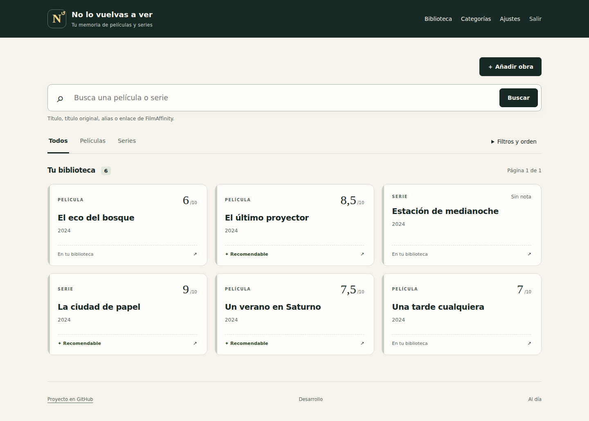

# No lo vuelvas a ver

**Tu memoria de películas y series.** Una biblioteca personal para comprobar qué has visto, qué nota pusiste, qué pensaste y si merece recomendarse. El nombre no significa que las obras sean malas.

Una instalación, una biblioteca compartida y una cuenta de acceso. Interfaz en español, móvil y escritorio. Sin registro público, telemetría, CDN, API de pago ni cuentas externas obligatorias. Toda la biblioteca funciona sin Internet; únicamente el autocompletado opcional de FilmAffinity necesita conectividad.

## Qué incluye V1

- Películas y series vistas; ficha general para cada serie, sin temporadas ni episodios.
- Alta por URL de FilmAffinity o manual; identidad única por ID y protección ante altas simultáneas.
- Título principal, original y alias con idioma; año, categorías múltiples, fecha de visionado opcional.
- Nota opcional de 1 a 10 en pasos de 0,5, anotaciones y marca Recomendable independiente.
- Búsqueda por títulos, alias, ID y URL; ignora mayúsculas y tildes. Filtros combinables, orden y paginación del servidor.
- Gestión de categorías, cambio de contraseña, JSON completo, CSV y importación con vista previa y conflictos explícitos.
- SQLite persistente, migraciones y copias consistentes antes de cambios de esquema.

No se incluye una biblioteca precargada. Las capturas y pruebas usan datos ficticios creados expresamente.



[Ver captura móvil con datos ficticios](docs/ejemplo-movil.png)

## Instalar en Docker o NAS

Necesitas Docker con Compose v2, almacenamiento local y CPU **linux/amd64 o linux/arm64**. Synology, UGREEN y otros NAS son ejemplos posibles si permiten Docker compatible. No se promete ARM de 32 bits ni compatibilidad con NAS sin Docker.

**Desde el móvil en Dockhand:** pega [compose.dockhand.yaml](compose.dockhand.yaml) y sigue [la guía de Dockhand](docs/dockhand.md). Docker descarga un archivo HTTPS del repositorio y construye automáticamente la imagen; no necesitas terminal ni Git en el constructor. Define ruta de datos, UID/GID, usuario y contraseña en el panel de variables y despliega con build habilitado.

Para instalar mediante imagen ya construida usa [compose.yaml](compose.yaml). Dockhand y Portainer son administradores alternativos, no forman parte de ninguno de los stacks. Solo se ejecuta un contenedor.

**Antes de la primera publicación en GHCR no hay una imagen pública garantizada.** Puedes construir la imagen en tu host Docker y usarla con el mismo stack:

```sh
docker build -t no-lo-vuelvas-a-ver:local .
```

Pon `APP_IMAGE=no-lo-vuelvas-a-ver:local`. En Dockhand selecciona la imagen local y desactiva cualquier opción de forzar su descarga. El build debe hacerse en el host Docker al que Dockhand despliega, después de descargar o clonar este repositorio. El stack de instalación no necesita el código montado.

Una vez publicada y hecha pública la imagen, usa `APP_IMAGE=ghcr.io/<namespace>/no-lo-vuelvas-a-ver:vX.Y.Z`, sustituyendo el namespace y la versión por los del paquete real. El workflow deriva el nombre del repositorio en minúsculas. La existencia de este código en GitHub no garantiza la disponibilidad del paquete.

### Variables del stack

Introduce estas variables en la pantalla del administrador o en un `.env` para CLI. El Compose pegado no usa `env_file` ni depende de un `.env` junto al editor.

| Variable | Valor que debes elegir |
| --- | --- |
| `APP_IMAGE` | Solo en `compose.yaml`: imagen pública con tag concreto, o `no-lo-vuelvas-a-ver:local` tras construirla. No se usa en `compose.dockhand.yaml` |
| `DATA_DIR` | **Ruta absoluta** a una carpeta existente del host Docker, local y escribible |
| `INITIAL_ADMIN_USER` | Nombre que elijas para la única cuenta |
| `INITIAL_ADMIN_PASSWORD` | Contraseña propia de 12–256 caracteres; no hay una predeterminada |
| `APP_UID`, `APP_GID` | UID/GID propietario de esa carpeta; por defecto `10001:10001` |
| `APP_PORT` | Puerto libre del host; por defecto `8000` |
| `COOKIE_SECURE` | `false` para HTTP privado; `true` para acceso únicamente por HTTPS |
| `SESSION_HOURS` | Expiración absoluta de sesión, de 1 a 168 horas; por defecto 12 |
| `FILMAFFINITY_ENABLED` | `false` por defecto; ver [limitaciones y acceso](docs/filmaffinity.md) |

Las variables `INITIAL_ADMIN_*` solo crean la cuenta si no existe. Recrear el contenedor no cambia la contraseña. El hash se guarda en SQLite. Cambia la contraseña en **Ajustes**; el cambio cierra todas las sesiones. Después del primer arranque puedes sustituir la contraseña inicial del stack por un valor no secreto de al menos 12 caracteres: se ignorará mientras exista la cuenta. No guardes secretos en Git ni en capturas del administrador.

### Dockhand

Usa **Dockhand de Finsys, [dockhand.pro](https://dockhand.pro/)**. En el entorno Docker elegido abre **Stacks → New Stack**, asigna un nombre y pega [compose.dockhand.yaml](compose.dockhand.yaml) para construir automáticamente desde el archivo de GitHub. Configura las variables de la tabla excepto `APP_IMAGE`, crea antes la carpeta de datos y despliega con build habilitado. Comprueba los logs y el estado saludable; abre el puerto del host e inicia sesión con tu cuenta. También puedes crear el stack desde Git, con la URL de este repositorio, referencia `main` y ruta `compose.dockhand.yaml`. Si tienes una imagen ya construida, puedes elegir `compose.yaml`. Los nombres de controles pueden cambiar según la versión.

Consulta [la guía de Dockhand desde el móvil](docs/dockhand.md) y [la guía general de instalación](docs/instalacion.md).

### Portainer

Selecciona un entorno **Docker Standalone**, abre **Stacks → Add stack → Web editor**, pega el Compose e introduce las variables en **Environment variables**. Pulsa **Deploy the stack**. Como alternativa elige **Git repository**, la URL del repositorio, referencia `refs/heads/main` y `compose.yaml`. Si utilizas una imagen local evita forzar su descarga. No selecciones Docker Swarm para esta guía.

### CLI

```sh
cp .env.example .env
chmod 600 .env
# Edita .env: imagen, ruta absoluta, UID/GID, usuario y contraseña propios.
docker compose config --quiet
docker compose up -d
docker compose ps
```

No ejecutes `docker compose config` sin `--quiet` en logs compartidos: puede mostrar la contraseña del stack. La guía explica [carpeta y permisos mínimos](docs/instalacion.md#carpeta-de-datos-y-permisos).

## Conservación y actualización

Los datos se guardan en `/data/library.sqlite3`, con WAL y timeout de escritura de 10 segundos. Guarda esa carpeta en disco local del host Docker; no uses SMB/NFS ni compartas SQLite entre hosts o varias instancias.

En **Ajustes** puedes exportar JSON versionado o CSV. Una importación valida el archivo entero, muestra conflictos por UUID/ID y permite omitirlos o cancelar; no sobrescribe fichas existentes. Máximo 10 MiB por archivo. CSV conserva caracteres y saltos de línea y neutraliza fórmulas.

Para una copia completa consistente:

```sh
docker compose exec library python -m app.cli backup /data/backups/copia-antes-de-actualizar.sqlite3
```

Usa un nombre nuevo para cada copia y guarda otra copia fuera de la carpeta de datos. No copies solo el fichero principal mientras SQLite escribe. Antes de una migración pendiente el arranque crea automáticamente otra copia consistente en `/data/backups`; si no puede crearla, no migra.

Para actualizar, fija el nuevo tag en `APP_IMAGE`, haz copia, descarga y recrea: `docker compose pull` y `docker compose up -d`. Cambiar a una imagen anterior puede requerir restaurar la base previa; **cambiar el tag no revierte los datos**. Sigue [mantenimiento, restauración y solución de problemas](docs/mantenimiento.md). El flujo normal nunca borra `/data` ni volúmenes.

Si instalaste con `compose.dockhand.yaml`, haz copia y solicita **reconstruir y recrear/desplegar** en Dockhand para descargar el código de `main`. Conserva la carpeta y las variables. [La guía móvil](docs/dockhand.md#cómo-actualizar) explica también cómo fijar un commit.

## Desarrollo y verificación

Python 3.12 y [uv](https://docs.astral.sh/uv/). Dependencias fijadas en `pyproject.toml` y `uv.lock`; `requirements.lock` incluye hashes para Docker.

```sh
uv sync --frozen
uv run --frozen pytest -q
uv run --frozen ruff check app migrations tests scripts
uv run --frozen python scripts/check_compose.py
uv run --frozen python scripts/check_compose.py compose.dockhand.yaml
docker build -t no-lo-vuelvas-a-ver:test .
uv run --frozen python tests/smoke_image.py no-lo-vuelvas-a-ver:test
uv run --frozen python tests/smoke_archive.py
```

Para arrancar en desarrollo, crea una carpeta absoluta vacía y define `DATA_DIR`, `INITIAL_ADMIN_USER` y `INITIAL_ADMIN_PASSWORD` en tu shell, sin incluir secretos en comandos compartidos. Ejecuta `uv run --frozen uvicorn app.main:app --host 127.0.0.1 --port 8000`. No se cargan datos de ejemplo automáticamente.

CI de pull requests ejecuta pruebas, validación de Compose, smoke de imagen y persistencia en runners amd64/arm64 sin publicar y sin secretos. La prueba de navegador genera datos sintéticos en una carpeta temporal. Las pruebas habituales de FilmAffinity usan HTML mínimo y respuestas simuladas; no consultan la web real.

El [informe de verificación](docs/verificacion.md) distingue resultados ejecutados y pasos pendientes. [Primera publicación en GHCR](docs/release.md): workflow preparado para etiquetas estables `vX.Y.Z`, solo tras pasar controles, con `GITHUB_TOKEN` y permisos mínimos. No se crea una etiqueta ni una release durante la preparación inicial.

## Arquitectura y licencia

FastAPI + SQLAlchemy + Alembic + SQLite + Jinja2 y JavaScript mínimo. Sin servidor frontend separado, Redis ni base externa. Recursos incluidos en la imagen. Una instancia y un worker. La búsqueda usa claves normalizadas y consultas paginadas; FTS5 no es necesario en V1 según la prueba de 10.000 obras, y complicaría las coincidencias parciales arbitrarias.

[AGENTS.md](AGENTS.md) · [CHANGELOG](CHANGELOG.md) · [ROADMAP](ROADMAP.md)

Código bajo [MIT](LICENSE). Los metadatos, nombres y contenidos de terceros conservan sus propios derechos; no quedan cubiertos por esta licencia. Proyecto independiente sin relación oficial con FilmAffinity. V1 no copia carteles, críticas ajenas, sinopsis extensas ni puntuaciones de FilmAffinity.
